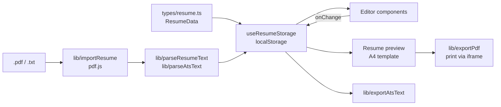

# Architecture

A small React + TypeScript app built with Vite, using plain CSS and no UI framework.

## Key modules

| Path | Responsibility |
| --- | --- |
| `src/types/resume.ts` | `ResumeData`, the single source of truth: theme, personal info, experience, skills, community, education, achievements. |
| `src/hooks/useResumeStorage.ts` | Loads and saves `ResumeData` to `localStorage`, and resets to `src/data/defaultResume.ts`. |
| `src/components/Editor/` | One editor per section; each receives its slice and an `onChange`. |
| `src/components/Resume/` | `ResumePreview` and `sections/*` render the two-column A4 template. |
| `src/lib/theme.ts` | Font options, size presets, typography ratios → CSS variables. |
| `src/lib/exportPdf.ts` | Clones the preview into a hidden iframe with `@page { size: A4; margin: 0 }` and calls `print()`. |
| `src/lib/exportAtsText.ts` | Serialises `ResumeData` to structured plain text. |
| `src/lib/importResume.ts` | Extracts text from PDF (pdf.js, lazy-loaded) or TXT, then parses it. |
| `src/lib/parseAtsText.ts` / `parseResumeText.ts` | Parse the app's own ATS format exactly, or arbitrary resume text heuristically. |
| `src/styles/resume-template.css` | Template and print styles. |

## Adding a new section (example)

1. Extend `ResumeData` in `types/resume.ts` and add defaults in `data/defaultResume.ts`.
2. Create `components/Editor/XEditor.tsx` and register it in `EditorPanel.tsx`.
3. Create `components/Resume/sections/XSection.tsx` and render it in `ResumePreview.tsx`.
4. Add it to `exportAtsText.ts` and `parseAtsText.ts` so ATS round-tripping keeps working.
5. Consider bumping the storage key version in `useResumeStorage.ts` if the shape changes incompatibly.
